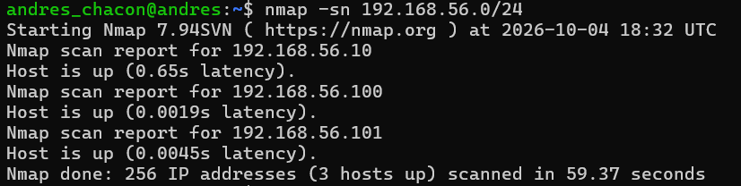
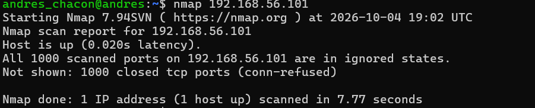
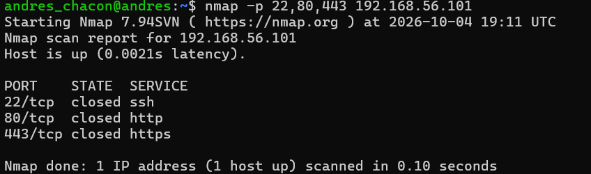
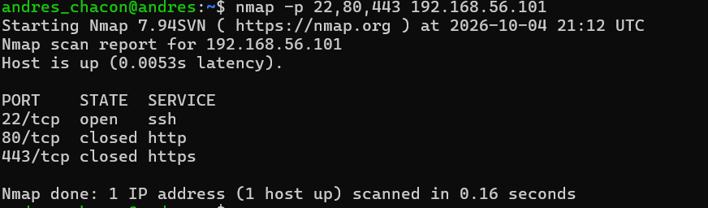
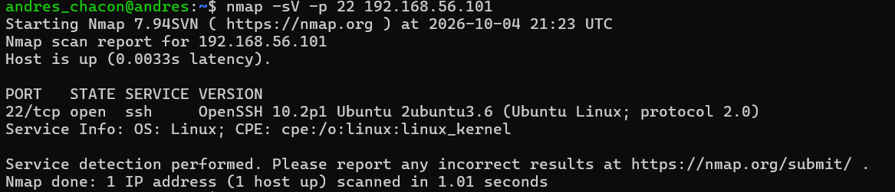

# Project 06 — Nmap: Network Discovery & Service Enumeration

## 1. Objective

The objective of this lab was to practice network host discovery, TCP port scanning, and service identification using Nmap in a controlled virtual environment.

The lab also explored how scan results can be compared against a known system configuration to identify expected services and potential deviations.

## 2. Lab Environment

* **Scanner:** Ubuntu on WSL2
* **Target:** Ubuntu Server LTS virtual machine running in VirtualBox
* **Scanning tool:** Nmap 7.94SVN
* **Target IP:** `192.168.56.101`
* **Lab network:** `192.168.56.0/24`
* **Connectivity:** VirtualBox Host-Only networking, with an additional NAT adapter on the target for Internet access when required

The target machine was configured as a controlled environment for testing host discovery and TCP port scanning.

## 3. Methodology

The lab followed a progressive workflow:

1. Discover hosts on the lab network.
2. Scan the target's TCP ports.
3. Identify the service and version associated with an open port.
4. Compare the observed results against the expected configuration.
5. Interpret the findings from a SOC/SNOC L1 perspective.

All scans were performed against the lab environment.

## 4. Lab 06.1 — Host Discovery

### Objective

Identify hosts that appear to be available on the lab network without performing a traditional port scan.

### Command

```bash
nmap -sn 192.168.56.0/24
```

### Observed Results

The scan reported three hosts as up:

* `192.168.56.10`
* `192.168.56.100`
* `192.168.56.101`

The target used for the subsequent tests was `192.168.56.101`.

The identities of the other discovered addresses were not established during this lab.

A subsequent targeted discovery check reported `.100` and `.101` as up, while `.10` was not reported in that check. This demonstrated that discovery results may vary between scans and should be validated when consistency matters.



### Key Learning

Host discovery identifies systems that appear reachable. It does not, by itself, establish their identity, ownership, purpose, or security status.

### Evidence

`01-host-discovery.png`

## 5. Lab 06.2 — TCP Port Scanning

### Objective

Determine the state of selected TCP ports on the target and observe how a controlled configuration change affects the results.

### 5.1 Initial Basic Scan

**Command:**

```bash
nmap 192.168.56.101
```

**Observed result:**

```text
Host is up.
All 1000 scanned ports are in ignored states.
Not shown: 1000 closed tcp ports (conn-refused)
```

Nmap reported the target as reachable, with all 1,000 scanned default TCP ports closed.

This demonstrated that a reachable host does not necessarily expose open services within the scanned ports.



### 5.2 Initial Scan of Selected Ports

**Command:**

```bash
nmap -p 22,80,443 192.168.56.101
```

**Observed result:**

```text
PORT    STATE   SERVICE
22/tcp  closed  ssh
80/tcp  closed  http
443/tcp closed  https
```

All three selected ports were reported as closed.

A closed port indicates that the target is reachable but no application is accepting connections on that port at the time of the scan.



### 5.3 Controlled SSH Configuration Change

To create a known open-service example, OpenSSH Server was installed on the Ubuntu target. The SSH service was then enabled and started.

The service state was checked locally, and listening sockets were inspected using:

```bash
sudo systemctl status ssh
sudo ss -lntp
```

The checks confirmed that SSH was running and listening on TCP port 22.

The same Nmap scan was then repeated.

**Command:**

```bash
nmap -p 22,80,443 192.168.56.101
```

**Observed result:**

```text
PORT    STATE   SERVICE
22/tcp  open    ssh
80/tcp  closed  http
443/tcp closed  https
```

TCP port 22 changed from `closed` to `open` after SSH was enabled. Ports 80 and 443 remained closed.

This was a controlled change that produced an observable difference in the scan results.



## 6. Lab 06.3 — Service Detection

### Objective

Identify the service and version information associated with the open TCP port.

### Command

```bash
nmap -sV -p 22 192.168.56.101
```

### Observed Result

```text
PORT   STATE SERVICE VERSION
22/tcp open  ssh     OpenSSH 10.2p1 Ubuntu 2ubuntu3.6
                      (Ubuntu Linux; protocol 2.0)

Service Info: OS: Linux; CPE: cpe:/o:linux:linux_kernel
```

Nmap identified SSH as the service running on TCP port 22 and reported the OpenSSH version/build information shown above.

This result was consistent with the local verification that the SSH service was running and listening on port 22.



### Key Learning

Service detection provides more information than a port-state result alone. However, identifying a service and its reported version does not automatically establish that the software is vulnerable or misconfigured.

## 7. Lab 06.4 — Expected vs. Discovered

### Objective

Compare the known target configuration with the results observed through Nmap.

| Expected configuration          | Observed result        | Assessment |
| ------------------------------- | ---------------------- | ---------- |
| Target is reachable             | Host reported as up    | Match      |
| SSH is enabled and listening    | `22/tcp open`          | Match      |
| SSH service is present          | SSH identified by Nmap | Match      |
| No HTTP service was configured  | `80/tcp closed`        | Match      |
| No HTTPS service was configured | `443/tcp closed`       | Match      |

The observed results matched the expected configuration of the target at the time of testing.

The comparison also demonstrated why context matters: the initial scan showed port 22 as closed, while the subsequent scan showed it as open after the SSH service was installed and activated.

### Conclusion

The comparison between expected and observed results helped validate the effect of the configuration change. In an operational environment, an unexpected difference could require further investigation to determine whether it resulted from an authorized change, a configuration issue, or another cause.

## 8. SOC/SNOC L1 Perspective

This lab demonstrated how Nmap results can support basic asset discovery, service exposure assessment, and configuration validation.

From a SOC/SNOC L1 perspective, the significance of a finding depends on the context of the asset and its expected configuration.

### Expected vs. Unexpected Exposure

An open port is not automatically evidence of malicious activity. Its significance depends on whether the service is expected, authorized, and appropriate for the system's role.

For example, if SSH appears open on a server where it is not expected, an initial triage could include:

* Checking the asset inventory and expected configuration.
* Identifying the service and reviewing the available version information.
* Checking for an approved change request or maintenance activity.
* Contacting the team responsible for the server or service.
* Reviewing relevant logs and related alerts when available.
* Documenting the finding and escalating it according to the applicable procedure if the discrepancy remains unexplained.

### Interpreting Port States

* **Open:** A service is accepting connections or responding as an open port.
* **Closed:** The host is reachable, but no application is listening on the scanned port.
* **Filtered:** Filtering prevents Nmap from determining whether the port is open or closed.

These states provide technical evidence, but they do not independently determine whether a security incident has occurred.

### Service and Version Identification

The `-sV` scan identified OpenSSH on port 22. This information can support further validation, but a version string alone is not sufficient to confirm a vulnerability.

Additional information about the operating system, installed package, applicable security updates, configuration, and known vulnerabilities may be needed.

### Documentation and Escalation

An L1 analyst should distinguish confirmed observations from assumptions, record relevant evidence, and follow the organization's incident and escalation procedures.

A finding may be resolved through validation of an authorized change, referred to the responsible operational team, or escalated for further security investigation if it remains unexplained.

## 9. Evidence

The following screenshots document the main stages of the lab:

| File                        | Description                                 |
| --------------------------- | ------------------------------------------- |
| `01-host-discovery.png`     | Host discovery across the lab subnet        |
| `02-basic-port-scan.png`    | Initial scan of the default 1,000 TCP ports |
| `03-specific-port-scan.png` | Initial scan of ports 22, 80, and 443       |
| `04-ssh-open.png`           | Repeat scan after SSH was enabled           |
| `05-service-detection.png`  | SSH service and version detection           |

## 10. Key Learning Outcomes

* Practiced host discovery using Nmap.
* Compared general and targeted TCP port scans.
* Observed the difference between closed and open ports after a controlled configuration change.
* Identified a service and version using `-sV`.
* Compared expected configuration with observed scan results.
* Practiced interpreting findings without automatically treating an open port or version string as proof of an attack or vulnerability.
* Applied basic SOC/SNOC L1 reasoning to validation, documentation, and escalation.

## 11. Conclusion

This lab provided practical experience with Nmap for network discovery, TCP port scanning, and service identification.

The controlled activation of SSH demonstrated how a system configuration change can affect scan results. Comparing those results with the expected configuration reinforced the importance of validating findings within their operational context.

From a SOC/SNOC L1 perspective, Nmap provides useful technical evidence, while asset context, authorized changes, supporting logs, and established procedures help determine the appropriate next action.
