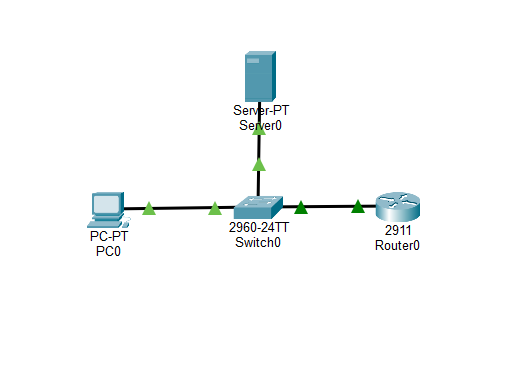
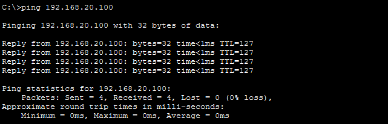
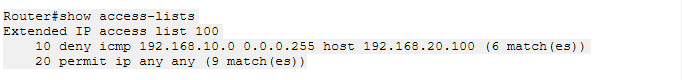
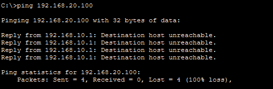
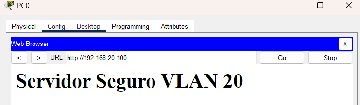
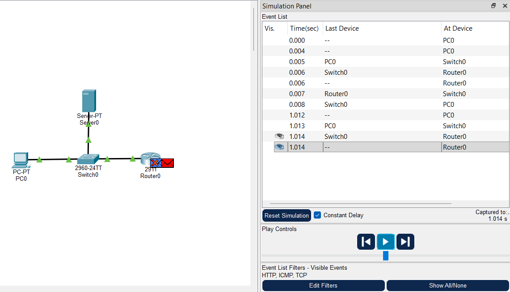

# Lab 05 - Inter-VLAN Traffic Control with Extended ACLs

## Objective

This lab configures and evaluates an Extended Access Control List (ACL) on a Router-on-a-Stick architecture to control traffic between VLAN 10 and VLAN 20.

The security policy is:

- Deny ICMP traffic from the VLAN 10 subnet to the web server in VLAN 20.
- Permit other IP traffic so the HTTP service remains accessible.

The lab compares network behavior before and after the ACL is applied.

---

## Network Topology

The topology contains one Cisco Catalyst 2960 switch and one router connected through an 802.1Q trunk. `PC0` is connected to VLAN 10, while `Server0` is connected to VLAN 20.

- `PC0` is the source host in the user segment.
- `Server0` is the destination web server.
- `Switch0` provides Layer 2 connectivity and VLAN segmentation.
- `Router0` provides inter-VLAN routing through Router-on-a-Stick.
- The ACL is applied inbound on the VLAN 10 router subinterface.



### VLANs

| VLAN | Purpose | Network |
|---|---|---|
| VLAN 10 | User segment (`USUARIOS`) | `192.168.10.0/24` |
| VLAN 20 | Server segment (`SERVERS`) | `192.168.20.0/24` |

---

## IP Addressing

| Device | Interface | IPv4 Address | Subnet Mask | Default Gateway | Role |
|---|---|---|---|---|---|
| Router0 | `Gi0/1.10` | `192.168.10.1` | `255.255.255.0` | N/A | VLAN 10 gateway |
| Router0 | `Gi0/1.20` | `192.168.20.1` | `255.255.255.0` | N/A | VLAN 20 gateway |
| PC0 | FastEthernet0 | `192.168.10.10` | `255.255.255.0` | `192.168.10.1` | VLAN 10 host |
| Server0 | FastEthernet0 | `192.168.20.100` | `255.255.255.0` | `192.168.20.1` | VLAN 20 web server |

---

## Initial Connectivity Troubleshooting

Before establishing the final connectivity baseline, the topology required initial troubleshooting.

The first ping test from `PC0` to `Server0` resulted in 100% packet loss:

```text
C:\>ping 192.168.20.100

Pinging 192.168.20.100 with 32 bytes of data:

Request timed out.
Request timed out.
Request timed out.
Request timed out.

Ping statistics for 192.168.20.100:
    Packets: Sent = 4, Received = 0, Lost = 4 (100% loss)
```

The connection between `Switch0` and `Router0` was disconnected and re-established. A second test produced partial packet loss:

```text
C:\>ping 192.168.20.100

Pinging 192.168.20.100 with 32 bytes of data:

Request timed out.
Reply from 192.168.20.100: bytes=32 time=1ms TTL=127
Reply from 192.168.20.100: bytes=32 time<1ms TTL=127
Reply from 192.168.20.100: bytes=32 time=1ms TTL=127

Ping statistics for 192.168.20.100:
    Packets: Sent = 4, Received = 3, Lost = 1 (25% loss)
```

The test was repeated after the connection became stable and reached 0% packet loss. The exact cause of the initial packet loss was not independently verified, so it is not attributed to a specific protocol or mechanism in this lab.

---

## Baseline Connectivity

Before applying the ACL, connectivity between VLAN 10 and VLAN 20 was verified.

### ICMP Baseline

A final ping test from `PC0` to `Server0` completed successfully with 0% packet loss. This established the working baseline required to compare network behavior before and after ACL enforcement.

### HTTP Baseline

HTTP access from `PC0` to the web server was verified using:

```text
http://192.168.20.100
```

The web page hosted on `Server0` was displayed, confirming that the application service was reachable before the ACL was applied.



---

## ACL Policy

An Extended ACL was configured on `Router0` to selectively control traffic entering the router from VLAN 10.

### Security Requirements

1. Deny ICMP traffic from `192.168.10.0/24` to `192.168.20.100`.
2. Permit other IP traffic.

This policy allows the web service to remain accessible while ICMP traffic to the server is blocked.

### ACL Rules

| Rule | Action | Traffic |
|---|---|---|
| 10 | Deny | ICMP from `192.168.10.0/24` to `192.168.20.100` |
| 20 | Permit | Other IP traffic |

The `permit ip any any` rule allows traffic that does not match the ICMP deny rule to continue through the router.

---

## ACL Configuration

The original ACL was removed and recreated using the correct wildcard mask for the `/24` VLAN 10 subnet. It was applied inbound on `Gi0/1.10`, filtering traffic from VLAN 10 as it enters `Router0`.

```text
Router#enable
Router#configure terminal
Router(config)#no access-list 100
Router(config)#access-list 100 deny icmp 192.168.10.0 0.0.0.255 host 192.168.20.100
Router(config)#access-list 100 permit ip any any
Router(config)#interface GigabitEthernet0/1.10
Router(config-subif)#ip access-group 100 in
Router(config-subif)#end
```

The configuration and match counters were verified with:

```text
Router#show access-lists
Extended IP access list 100
    10 deny icmp 192.168.10.0 0.0.0.255 host 192.168.20.100 (6 match(es))
    20 permit ip any any (9 match(es))
```



---

## ACL Verification and Test Results

### 1. ICMP Traffic - Blocked

After applying the ACL, an ICMP ping was executed from `PC0` to `Server0`:

```text
C:\>ping 192.168.20.100

Pinging 192.168.20.100 with 32 bytes of data:

Reply from 192.168.10.1: Destination host unreachable.
Reply from 192.168.10.1: Destination host unreachable.
Reply from 192.168.10.1: Destination host unreachable.
Reply from 192.168.10.1: Destination host unreachable.

Ping statistics for 192.168.20.100:
    Packets: Sent = 4, Received = 0, Lost = 4 (100% loss)
```

The ICMP traffic was denied by ACL rule 10. The test also showed `Destination host unreachable` responses from the local gateway `192.168.10.1`.



### 2. HTTP Traffic - Permitted

HTTP access was tested from the browser on `PC0` using:

```text
http://192.168.20.100
```

The web page continued to load successfully after the ACL was applied. This demonstrated that non-ICMP IP traffic was still permitted by the ACL.



The resulting behavior was:

- ICMP traffic: blocked.
- TCP/HTTP traffic: permitted.

### 3. ACL Match Counters

The counters confirmed that traffic matched both ACL rules during testing:

- Rule 10 recorded 6 matches.
- Rule 20 recorded 9 matches.

These counters demonstrate that ACL 100 was actively processing traffic during the tests.

---

## Simulation Mode Analysis

Packet Tracer Simulation Mode was used to observe the blocked ICMP traffic.

The ICMP packet reached `Router0` through the VLAN 10 subinterface and was discarded when it matched ACL rule 10. The simulation provided a visual representation of the difference between normal forwarding and traffic filtered by the ACL.



---

## Key Observations

- A working connectivity baseline was established before applying the ACL.
- ACL rules were evaluated sequentially.
- ICMP traffic matched rule 10 and was denied before reaching VLAN 20.
- Blocking ICMP did not prevent HTTP access from reaching the web server.
- ACL match counters provided evidence that traffic was processed by the configured rules.
- Initial connectivity problems were resolved before the final baseline, preventing them from being confused with ACL behavior.

---

## SOC L1 Perspective

From a SOC L1 perspective, this lab demonstrates concepts relevant to network traffic analysis:

- **Baseline versus blocked traffic:** Expected connectivity makes it easier to identify traffic intentionally filtered by a security control.
- **Source and destination analysis:** The ACL identifies both the originating subnet and the destination server.
- **Protocol analysis:** ICMP and TCP/HTTP traffic can be treated differently according to a defined access policy.
- **Access control visibility:** ACL match counters provide evidence that traffic is being processed by specific filtering rules.
- **Troubleshooting before escalation:** Link and connectivity conditions should be checked before interpreting packet loss as a security event or application failure.

These concepts provide a foundation for understanding how network security controls affect traffic observed by monitoring and security operations teams.

---

## Evidence

| Evidence | Description |
|---|---|
| `01-acl-topology.png` | Packet Tracer topology showing `PC0`, `Switch0`, `Router0`, and `Server0`. |
| `02-baseline-connectivity.png` | Baseline connectivity verification before ACL enforcement. |
| `03-acl-configuration.png` | ACL configuration and `show access-lists` output with match counters. |
| `04-blocked-icmp.png` | `PC0` command prompt showing `Destination host unreachable` and 100% packet loss after ACL enforcement. |
| `05-allowed-http.png` | `PC0` browser showing successful HTTP access to `Server0`. |
| `06-acl-simulation.png` | Packet Tracer Simulation Mode showing the ICMP packet being discarded at `Router0`. |

---

## Conclusion

This lab demonstrated how an Extended ACL can selectively control traffic between VLANs in a Router-on-a-Stick topology.

A working connectivity baseline was established before applying the ACL. After enforcement, ICMP traffic from VLAN 10 to the server in VLAN 20 was blocked, while HTTP access remained available.

The `show access-lists` output and Packet Tracer Simulation Mode provided additional evidence of the ACL's behavior.

The exercise reinforced the relationship between network segmentation, routing, protocol-level traffic control, and operational analysis from a SOC L1 perspective.
