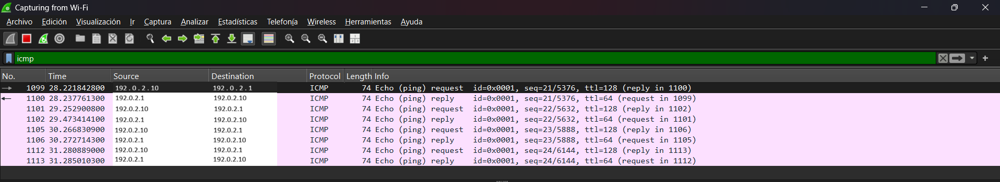
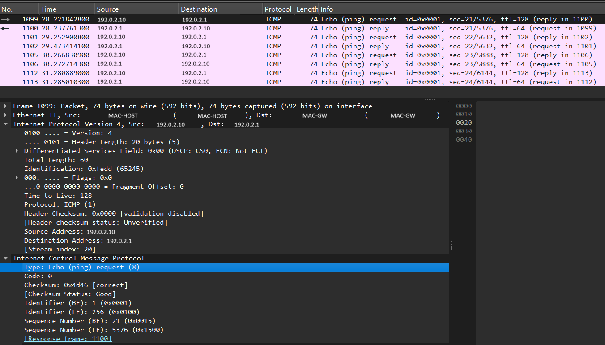
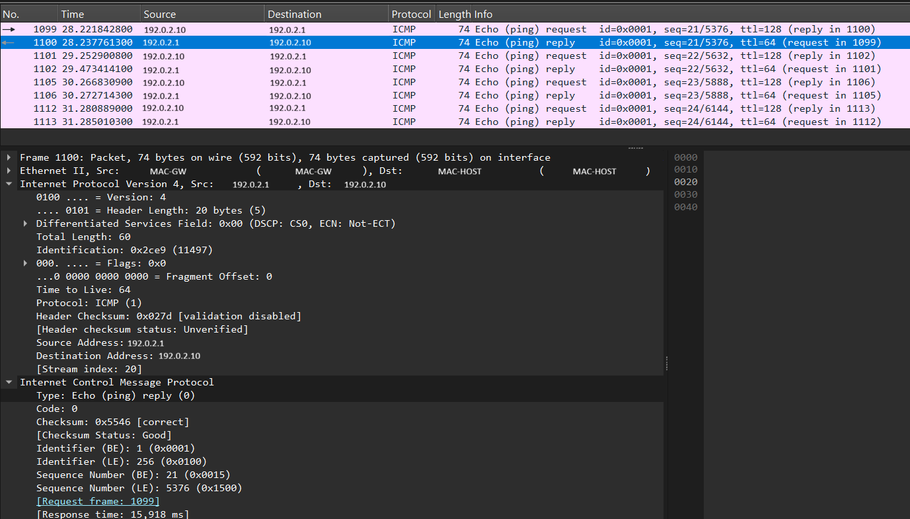
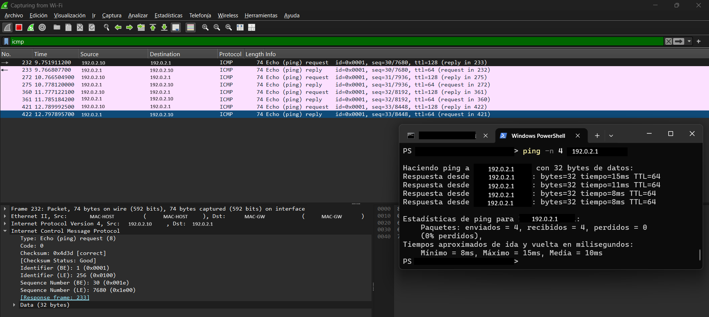

# Project 07 — Wireshark: Network Traffic Analysis

## 1. Project Overview

This project focuses on capturing and analyzing network traffic using **Wireshark** to understand the behavior of ICMP and ARP, interpret packet fields, and observe how a connectivity test is reflected in a packet capture.

The lab was performed on a Windows computer connected through Wi-Fi. Wireshark was used to inspect captured packets, while Windows PowerShell was used to perform a connectivity test with `ping`.

This project is part of my preparation for entry-level **SOC L1 / Blue Team** roles, where understanding network traffic, validating communications, and documenting observations are relevant to initial alert and incident analysis.

## 2. Objectives

- Capture network traffic using Wireshark.
- Identify ICMP Echo Request and Echo Reply messages.
- Interpret relevant packet fields, including IP addresses, type, code, sequence number, and TTL.
- Recognize ARP Request and ARP Reply messages.
- Observe ICMP traffic associated with a connectivity test.
- Apply display filters to facilitate packet analysis.
- Document the results and protect local network information when publishing evidence.

## 3. Lab Environment

| Component | Description |
|---|---|
| Operating system | Windows |
| Packet analysis tool | Wireshark 4.6.9 |
| Capture interface | Wi-Fi |
| Terminal | Windows PowerShell |
| Main protocol | ICMP |
| Additional protocol | ARP |
| Connectivity test | `ping -n 4` to the local gateway |

The capture was performed on the computer's Wi-Fi interface. Therefore, the observed packets represent traffic that Wireshark could capture on that interface during the lab. They do not necessarily represent all traffic present on the network.

## 4. Privacy and Evidence Anonymization

The published evidence was visually edited to avoid exposing unnecessary information about the local network.

- The computer's original IP address was visually replaced with `192.0.2.10`.
- The gateway's original IP address was visually replaced with `192.0.2.1`.
- MAC addresses were hidden and replaced with the explanatory labels `MAC-HOST` and `MAC-GW`.
- Other identifiers that were not necessary to demonstrate the lab objectives were hidden where appropriate.

The addresses `192.0.2.10` and `192.0.2.1` belong to an IP range reserved for documentation. They are **visual substitutes**, not the original network configuration values or addresses configured to perform the test.

The labels `MAC-HOST` and `MAC-GW` are explanatory references, not actual MAC addresses. The anonymization was intended to protect identifying information without changing the technical results documented in the lab. The reported fields and statistics correspond to the evidence used for this project.

## 5. Lab Procedure

### 5.1. ICMP Traffic Capture and Identification

Wireshark was used to capture traffic from the Wi-Fi interface. The following display filter was applied:

```text
icmp
```

This filter displayed ICMP packets, including Echo Request and Echo Reply messages.

The source and destination addresses were examined to identify the direction of communication.

**Observations:**

- Echo Request represents an echo request message.
- Echo Reply represents an echo response.
- In a request-response exchange, the source and destination IP addresses are reversed between the request and the corresponding reply.
- The sequence number helps distinguish individual requests and responses within a series of tests.



### 5.2. ICMP Echo Request Analysis

An Echo Request packet was selected and its fields were examined in Wireshark's packet details pane.

Relevant fields included:

- **Type:** 8 — Echo Request.
- **Code:** 0.
- **Source Address:** anonymized source IP address.
- **Destination Address:** anonymized destination IP address.
- **Sequence Number:** identifies the request's position within the sequence.
- **TTL:** the remaining hop limit in the IP header.

Type 8 and Code 0 are the standard values for an ICMP Echo Request.

TTL does not represent time in milliseconds. It is an IP header field that limits the number of hops a packet can traverse.



### 5.3. ICMP Echo Reply Analysis

An Echo Reply packet was examined to identify the fields associated with the response.

Relevant fields included:

- **Type:** 0 — Echo Reply.
- **Code:** 0.
- **Source Address:** anonymized source IP address.
- **Destination Address:** anonymized destination IP address.
- **Sequence Number:** the sequence number of the selected response.
- **TTL:** the remaining hop limit in the IP header.

The reply uses the reverse source and destination IP addresses compared with the corresponding request. Comparing both packets helps demonstrate the ICMP request-response exchange.



### 5.4. Additional ARP Exploration

ARP messages present in the capture were examined to identify requests and replies associated with resolving IPv4 addresses to MAC addresses on the local network.

The observed messages included:

- **ARP Request:** `Who has ...? Tell ...`
- **ARP Reply:** `... is at ...`

The examined request asked for the MAC address associated with the gateway's IP address, while the reply provided the corresponding MAC address. In the published evidence, IP addresses were visually replaced and MAC addresses were hidden.

ARP serves a different purpose from ICMP. ARP resolves IPv4 addresses to MAC addresses on the local link, while ICMP includes control and diagnostic messages such as Echo Request and Echo Reply.

**Limitation:** the presence of ARP and ICMP packets in the same capture does not, by itself, prove that the observed ARP messages were triggered by the `ping` test. The available evidence was insufficient to establish this correlation conclusively, so it is not presented as a confirmed result.


### 5.5. PowerShell Connectivity Test

A connectivity test consisting of four requests to the local gateway was performed using the following command:

```powershell
ping -n 4 192.168.101.1
```

The address shown in the command is the original address used during the test. In the published evidence, it was visually replaced with `192.0.2.1`.

The documented execution produced the following results:

| Metric | Result |
|---|---:|
| Packets sent | 4 |
| Packets received | 4 |
| Packets lost | 0 |
| Packet loss | 0% |
| Minimum time | 8 ms |
| Maximum time | 15 ms |
| Average time | 10 ms |

The results indicate that all four requests received replies during this execution. Packet loss was 0% for this specific test.

Wireshark was used to observe ICMP traffic associated with the connectivity activity. These results describe only the documented execution and do not guarantee that the connection will behave identically at other times.



## 6. Evidence

The screenshots are organized in the `evidence/` directory.

| File | Description |
|---|---|
| `01-icmp-ping-capture-edit.png` | Overview of captured ICMP Echo Request and Echo Reply packets. |
| `02a-icmp-request-reply-details-edit.png` | Packet details for an ICMP Echo Request. |
| `02b-icmp-request-reply-details-edit.png` | Packet details for an ICMP Echo Reply. |
| `03-arp-request-reply-edit.png` | ARP Request and ARP Reply examples from the capture. |
| `04-icmp-connectivity-test-edit.png` | Wireshark capture alongside the PowerShell ping command and its results. |

The published evidence was anonymized. The substituted visual values must not be interpreted as the original network addresses.

## 7. Results and Conclusions

The lab activities demonstrated the ability to:

- Identify ICMP Echo Request and Echo Reply packets.
- Recognize Type 8, Code 0 for requests and Type 0, Code 0 for replies.
- Interpret source and destination IP addresses and observe their reversal between a request and its corresponding reply.
- Understand the sequence number and TTL as separate fields with different purposes.
- Identify ARP Request and ARP Reply messages and understand their role in resolving IPv4 addresses to MAC addresses.
- Perform a four-request connectivity test and record its statistics.
- Apply display filters and prepare anonymized evidence for technical documentation.

This lab helped reinforce basic network traffic analysis and the distinction between observing packets, identifying their purpose, and drawing conclusions supported by evidence.

The additional ARP investigation did not establish a confirmed relationship between the observed ARP messages and the ICMP test. This limitation is documented to distinguish verified observations from hypotheses that would require further capture or analysis.

## 8. Relevance to SOC L1 Responsibilities

The skills practiced in this lab provide a foundation for initial network connectivity and traffic analysis in a SOC environment.

Examples include:

- **Observation:** identifying the types of packets present in a capture.
- **Validation:** examining technical fields to understand what a packet represents.
- **Contextualization:** distinguishing requests from responses and avoiding conclusions based on an isolated field.
- **Documentation:** recording measured results, available evidence, and limitations.
- **Analytical caution:** avoiding the assumption that a communication is malicious simply because a packet or protocol is observed.

This project is a network traffic analysis and basic connectivity troubleshooting exercise. By itself, it does not constitute an incident investigation, a threat detection, or a security assessment of the network.

## 9. Project Structure

```text
07-wireshark-network-traffic-analysis/
├── README.md
└── evidence/
    ├── 01-icmp-ping-capture-edit.png
    ├── 02a-icmp-request-reply-details-edit.png
    ├── 02b-icmp-request-reply-details-edit.png
    ├── 03-arp-request-reply-edit.png
    └── 04-icmp-connectivity-test-edit.png
```

## 10. Tools and Protocols

- **Wireshark:** packet capture and analysis.
- **Windows PowerShell:** connectivity testing.
- **ICMP:** observation of Echo Request and Echo Reply messages.
- **ARP:** observation of address resolution requests and replies.

---

**Project status:** Lab completed and evidence prepared for review and publication. The specific correlation between the observed ARP packets and the ICMP test remains a possible future extension, not a demonstrated result.